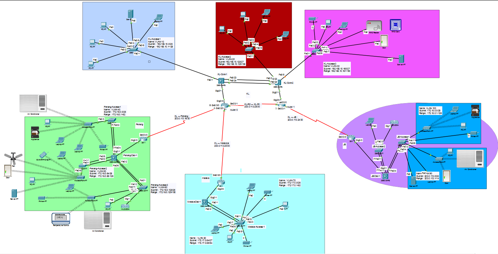

# Shellos Enterprise Network Upgrade

Design, configuration and security hardening of a four-site enterprise network (Kuala Lumpur HQ, Penang, Johor Bahru, Malacca), built and tested in **Cisco Packet Tracer**.

> University group project, Switching and Routing Essentials, Asia Pacific University (APU), 2026.



## Overview

Shellos is a fictional networking company with a headquarters and three branch sites. The brief was to replace a flat, unprotected network with a segmented, redundant and secured design, with centralised services hosted in a server farm.

## What was implemented

| Area | Details |
|---|---|
| Addressing | IPv4 with VLSM per site, plus IPv6 addressing |
| Switching | VLANs, 802.1Q trunking, voice VLAN, EtherChannel (LACP), PortFast |
| Routing | Multilayer-switch SVIs, OSPF (single area, 5 routers), OSPFv3 |
| Redundancy | HSRP on the KL core switches, redundant links, EtherChannel |
| Services | Centralised DHCPv4/DHCPv6 with relay agents, DNS, HTTP, HTTPS, FTP (JB server farm) |
| Wireless | Cisco 2500 WLCs at Penang and JB, WPA2 SSIDs |
| IoT | RFID access control system managed from the server farm |
| Layer 2 security | Port Security (sticky MAC), DHCP Snooping, Dynamic ARP Inspection, BPDU Guard, Root Guard |
| Device hardening | Enable secret, console/VTY passwords, access control |
| Verification | show-command outputs, ping and traceroute between all sites |

## Sites

- **KL (HQ):** collapsed core/distribution with two L3 switches running HSRP, three department VLANs, RFID/IoT devices
- **Penang:** distribution switch, three access switches, WLC and wireless access points, IoT devices
- **Johor Bahru:** server farm (DHCP, DNS, web, FTP, IoT server), WLC, IT and wireless VLANs
- **Malacca:** distribution switch and a single access switch

## Repository structure

```
.
├── packet-tracer/
│   └── Shellos_Enterprise_Network.pkt   # open with Cisco Packet Tracer
├── images/
│   └── network-topology.png
└── README.md
```

## How to run

1. Install [Cisco Packet Tracer](https://www.netacad.com/courses/packet-tracer) (free with a NetAcad account).
2. Open `packet-tracer/Shellos_Enterprise_Network.pkt`.
3. Use the CLI on any device and try `show vlan brief`, `show ip ospf neighbor`, `show standby brief`, `show ip dhcp binding`.
4. From a client PC, ping `203.0.113.2` or browse to `www.shellos.com`.

## My contribution (Member 4: Wireless & DHCP)

- **DHCPv4:** configured the central DHCP server on the JB Server Farm with one pool per VLAN across all four sites (KL, Penang, JB, Malacca), reached through `ip helper-address` relay agents on the distribution/core switches
- **Wireless LAN Controllers:** set up the Cisco WLCs at Penang and JB, including management interface, dynamic interfaces and WLANs
- **WPA2 authentication:** secured the staff SSIDs at both sites
- **VLAN-to-SSID mapping:** mapped each SSID to its VLAN through WLC dynamic interfaces and trunked the WLC ports
- **Verification:** confirmed wireless clients at both sites receive IP addresses via DHCP (Penang is fully wireless through the WLC; JB is mixed wired and WLC-managed)

## Skills demonstrated

DHCP, wireless (WLC, WPA2), network design, VLSM, VLANs and trunking, EtherChannel, OSPF, HSRP, DHCP, DNS, WLAN, Layer 2 security, CLI configuration and troubleshooting, technical documentation.

## Team

Group of six students, APU. <!-- Optional: add teammates' names or GitHub links with their permission -->

## Notes

This is a lab simulation. All passwords and addresses in the `.pkt` file are for the simulated environment only.
